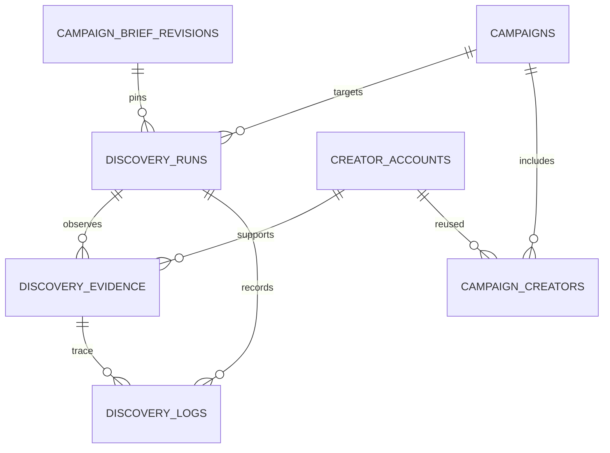

# STEP 3 — Discovery DB 및 MCP 인터페이스 설계 v0.1

작성: 2026-10-21. 상태: **설계 / 미구현 / Work 연동 미검증**. 적용 migration·API·실행 버튼은 추가하지 않는다. PostgreSQL/Drizzle/Next.js와 기존 조직·프로젝트 권한, 불변 브리프·파일 버전을 유지한다. [실증 절차](PHASE-0-RUNBOOK.md)의 실제 결과에 따라 후속 PR에서 구체화한다.

## 불변 조건과 저장 경계

- run 하나는 캠페인 하나·플랫폼 하나·타겟팅 사본 하나를 사용한다. 국가·플랫폼·조건은 캠페인 소유이며 프로젝트에 옮기지 않는다.
- 캠페인의 현재 타겟팅은 편집 가능하므로 `brief_version` FK만으로 실행 조건을 재현할 수 없다. run에 타겟팅 JSON과 정규화 규칙 버전·SHA-256을 별도 고정한다. 브리프는 기존 `campaign_brief_revisions`를 참조한다.
- 브리프 내 파일의 `project_asset_versions`와 실제 S3 version ID를 그대로 사용한다. 새 자료나 새로운 프로필 정보가 과거 run·evidence를 덮어쓰지 않는다.
- creator account는 **조직 내부 플랫폼 계정**이다. 서로 다른 캠페인/프로젝트에서 재사용한다. 조직을 넘는 자동 매칭·데이터 공유는 하지 않는다. 동일 인물의 여러 SNS 계정 병합은 이번 설계 범위가 아니다.
- SNS를 직접 봤다는 관찰과 그 주장의 검토 상태를 분리한다. 인증된 MCP 쓰기, URL 형식 검증, 해시 일치가 실제 SNS 방문 사실을 증명하지는 않는다.
- STEP 4 점수·승인·STEP 5 발송 상태를 발견 단계의 상태와 혼합하지 않는다. 발굴 연결 생성만으로 승인·연락 가능 상태가 되지 않는다.

## 관계



아래 테이블은 신규 설계 계약이며 아직 구현된 테이블이 아니다.

## 1. discovery_runs

| 필드 | PostgreSQL 형식/의미 |
| --- | --- |
| id, organization_id, project_id, campaign_id | uuid, NOT NULL. 기존 조직/프로젝트/캠페인 복합 FK |
| brief_version | integer. 기존 `(organization_id, project_id, campaign_id, version)` FK |
| platform | text CHECK instagram/tiktok/youtube. 고정한 targeting의 선택 플랫폼에 포함되는지 서비스 검증 |
| execution_source | text CHECK `work_manual_task` / `manual_import` / `codex_test`. 후속 API runtime은 별도 값과 실증으로 추가 |
| status | text CHECK `prepared`, `collecting`, `awaiting_review`, `completed`, `partial`, `blocked`, `failed`, `cancelled` |
| targeting_snapshot, targeting_sha256, snapshot_schema_version | jsonb, text(64자리 SHA-256), integer. 국가/플랫폼/카테고리/팔로워 상하한/목표/추가·제외 조건 고정 |
| requested_count, time_budget_seconds | integer > 0, Phase 0은 5명/1800초. 수량 상한은 서버 설정 |
| work_task_reference | nullable text. 실제 환경에서 제공되는 비공개 참조만 사용. 가짜 session/run ID를 만들지 않음 |
| environment_snapshot, capability_receipt_id | jsonb, nullable uuid. 실증 환경과 실제 연결 검증 참조. 비밀값 제외 |
| started_at, submitted_at, reviewed_at, ended_at | timestamptz nullable. 실제 이벤트 시 기록하며 prepared에는 실행 시작 시각 없음 |
| outcome_summary, limitations | jsonb/text. evidence/log에서 서버가 집계하고 실패·null 사유 보존 |
| created_by, updated_by, created_at, updated_at, lock_version | 기존 users FK, timestamptz, integer. 낙관적 잠금과 감사 |

모든 시간은 `timestamptz`, wire format은 UTC ISO 8601이다. 텍스트 상태는 TS enum뿐 아니라 DB CHECK로 보호한다. 생성/수정자는 서버가 정하며 MCP가 임의 user/organization ID를 보낼 수 없다.

상태 전이 설계: `prepared → collecting → awaiting_review → completed/partial/blocked`; 실제 오류/취소는 `failed/cancelled`. `prepared` 생성은 Work 시작 요청이 아니다. 첫 실제 탐색 로그(접속 실패 포함)를 수락하고 수행 근거를 확인할 때 collecting으로 이동한다. 실제 실행 전에는 running 진행률이나 가짜 Work task ID가 없다. 제출만으로 completed가 되지 않는다. 운영자가 5명/검색/콘텐츠/제약을 검토한 뒤 확정한다. 종료된 run에 추가 관찰이 필요하면 새 run을 만든다. 실패 run도 남긴다.

`capability_receipt_id`는 후속 연결 실증 PR에서 관리할 검증 레코드(환경·서버 build·scope·DB probe receipt)를 가리킨다. nullable 설계가 현재 연동을 암시하지 않는다. `work_manual_task` 출처 저장은 그 Work 작업 근거가 있을 때만 허용하며 수동 파일 입력은 manual_import다. Work 연동 검증 완료 표시는 run의 completed와 별도 capability gate로 계산한다.

## 2. creator_accounts

| 필드 | 형식/규칙 |
| --- | --- |
| id, organization_id | uuid. unique `(organization_id, id)` |
| platform, platform_account_id | text, nullable 안정 ID. 공급자 ID를 실제 확인한 경우에만 입력 |
| canonical_profile_url, current_handle, display_name | text. 정규화 URL/변경 가능한 handle/표시 이름 |
| identity_state | `provisional` / `resolved` / `conflict` / `merged` |
| merged_into_id | nullable uuid, 같은 조직·플랫폼 계정 FK. 원행/이전 참조는 삭제하지 않음 |
| first_seen_at, last_seen_at, archived_at | timestamptz. 삭제/비공개 전환은 이력으로 기록 |
| created_by, updated_by, created_at, updated_at | 서버 감사 필드 |

안정 ID는 unique `(organization_id, platform, platform_account_id) WHERE platform_account_id IS NOT NULL`로 중복을 막는다. 공개 UI에서 안정 ID가 없으면 추정/스크래핑으로 만들지 않고 정규화 URL을 **잠정 식별자**로 쓴다. YouTube channel ID와 @handle을 같은 종류의 안정 ID로 취급하지 않는다.

변경·재할당되는 handle/URL은 영구 식별자가 아니므로 보조 `creator_account_aliases`(org, platform, normalized_url/handle, account_id, valid_from/to, evidence_id)를 둔다. 활성 alias에만 부분 unique를 적용한다. 새 URL/안정 ID 충돌은 `identity_conflict`로 대기하고 자동 덮어쓰기/병합하지 않는다. 동시 upsert는 DB unique + transaction/retry로 1행을 유지한다. 병합은 사람이 근거를 검토하고 campaign/evidence 참조를 이력 보존 방식으로 처리하는 별도 작업이다.

MCP는 URL에서 인증·tracking·fragment를 제거하고 플랫폼별 허용 profile 경로만 받는다. 표준 URL은 Instagram `/handle/`, TikTok `/@handle`, YouTube `/channel/ID`(확인 시) 또는 `/@handle`이다. handle 대소문자/유니코드 규칙은 플랫폼별 실증 후 정하며 표시 원문은 유지한다. 원본 계정 URL이 없는 검색 엔진 결과는 직접 확인된 계정으로 승격하지 않는다.

## 3. discovery_evidence

| 필드 | 형식/규칙 |
| --- | --- |
| id, organization_id, project_id, campaign_id, run_id, creator_account_id | uuid. run의 캠페인/조직/프로젝트 및 계정 조직을 FK로 보장 |
| kind | `profile_observation`, `content_observation`, `metric_observation`, `identity_observation` |
| observation_method | `sns_browser`, `supplemental_web`, `manual_import`, `codex_test` |
| source_url, profile_url, platform_content_id | 허용된 SNS 원본 HTTPS URL, nullable 실제 콘텐츠 ID. 검색엔진 링크는 별도 method의 근거 |
| observed_at, recorded_at, published_at | 확인 시각, 서버 저장 시각, nullable 실제 게시 시각 |
| facts, limitations | schema version이 있는 jsonb. 짧은 관찰 근거와 필드별 확인/미확인 사유 |
| search_log_id, work_trace_reference | 실제 검색 경로 연결과 비공개 수행 기록 참조. 없으면 null |
| capture_asset_version_id, payload_sha256 | nullable 비공개 캡처의 기존 파일 버전 FK, canonical payload SHA-256 |
| supersedes_id, created_by, created_at | 정정 시 새 증거가 이전 증거를 가리킴. UPDATE 금지 |

`facts.metrics[]` 원소는 `name`(followers/subscribers/views/likes/comments), `raw_display`, `value`(nullable bigint 범위), `precision`(exact/rounded/hidden/unavailable), `unit`, `observed_at`, `source_url`을 갖는다. 콘텐츠별 공개 수치와 계정 수치를 혼합하지 않는다. `recent_basis`, 관찰된 콘텐츠 언어/창작자 국가 근거와 `audience_country=unknown`을 구분한다. 값/시각/원본 링크 중 하나가 없으면 해당 필드의 verified를 허용하지 않는다. 정밀도와 필터 판정은 원문보다 강하게 만들지 않는다.

계정별 `profile_opened_directly`, 콘텐츠별 실제 열람 주장, 내부 검색 로그 ref는 각각 저장한다. **검토된 직접 SNS 계정 수**는 실제 Work 출처, SNS 관찰, 검색 경로, 프로필+최근 콘텐츠 근거와 사람 검토를 모두 충족한 고유 계정으로 계산한다. 자료 수를 계정 수로 세지 않는다.

캡처는 원본 대량 복사 대신 필요한 관찰만 보관한다. `capture_asset_version_id`는 같은 org/project의 `project_asset_versions` 복합 FK이며 기존 private download 검증을 재사용한다. 원본 S3 키/서명 URL/쿠키/페이지 전체 HTML은 MCP facts/log에 넣지 않는다. 캡처가 없어도 실제 원본 링크/시각/수행 기록을 요구한다.

정정/검토는 별도 append-only `discovery_evidence_reviews`(evidence_id, verdict accepted/rejected/needs_review, reason, reviewer_id/time)로 남긴다. Agent는 accepted를 지정할 수 없다. 기존 증거는 UPDATE/일반 DELETE를 차단한다. 보존 기한·삭제 요청 처리 시 제한된 관리 작업과 tombstone/audit로 참조를 보호하는 정책을 별도 설계한다. SHA는 기록 변조 확인용이며 SNS 내용의 진실성 서명이 아니다.

## 4. campaign_creators

`id`, `organization_id`, `project_id`, `campaign_id`, `creator_account_id`, `first_discovery_run_id`, `first_evidence_id`, `discovery_state`, `created_by/updated_by`, timestamps. unique `(organization_id, campaign_id, creator_account_id)`로 같은 계정의 캠페인 중복 연결을 거절한다. 다른 캠페인의 타겟팅/평가/보류 상태를 공유하지 않는다.

`discovery_state`는 `verification_pending/direct_sns_verified/blocked/duplicate`로 제한한다. direct_sns_verified는 승인된 증거에 따른 서버 계산이다. 신규 발견은 기본 verification_pending이다. 새 run에서 재발견되면 기존 연결을 재사용하고 해당 run/evidence는 추가된다. run 1개에만 종속시키지 않는다. STEP 4 승인/점수는 후속 테이블에서 처리하며 여기서 `approved`를 만들지 않는다.

## 5. discovery_logs

append-only `id`, org/project/campaign/run ID, `sequence`, `event_type`, `occurred_at`, `recorded_at`, `source_url`, `query`, `parent_log_id`, nullable `evidence_id/account_id`, `outcome`, `failure_code`, `message`, `correlation_id`, `created_by/created_at`. unique `(run_id, sequence)`를 서버에서 할당하고 org/run 시간 인덱스를 둔다.

검색 결과 URL·질의·실제 탭/필터→프로필→콘텐츠의 경로를 parent_log_id로 연결한다. native_search, supplemental_web, login_required, captcha, rate_limit, submit 등의 구분을 보존한다. 같은 run 외 parent/evidence를 연결할 수 없게 scoped FK를 쓴다. 제한 화면도 작업의 실제 결과이며 로그 실패를 숨긴 completed를 허용하지 않는다. HTTP 상태는 실제 관찰한 경우에만 기록한다.

## FK, 무결성 및 이관

- 신규 run은 `(org,project,campaign)` 캠페인 FK 및 `(org,project,campaign,brief_version)` 브리프 FK. evidence/log는 `(org,project,campaign,run)`을 참조하고 계정은 `(org,account)`를 참조한다. cross-project evidence/파일 참조와 다른 조직 계정을 DB에서 거절한다.
- 불변 대상: run의 캠페인·플랫폼·출처·브리프·타겟팅 snapshot/hash, 모든 관찰/로그/검토. 상태/집계 변경만 서비스가 조건부 처리하고 audit를 남긴다.
- 브리프 삭제를 신규 FK가 방어하도록 한다. migrations `0000–0002`를 고치거나 실행 데이터를 backfill해서 가짜 발견 run/계정을 만들지 않는다. 신규 additive migration은 후속 schema PR에서 생성한다. 기존 브리프/파일 트리거를 재검증한다.
- reviewer의 현재 권한은 기존 앱에서 조회 전용이다. 이 설계에서 자동 승격하지 않는다. 실증 판정은 현행 writer 역할(admin/manager)의 운영자가 수행하고, STEP 4 권한 확장은 별도 PR/정책으로 결정한다.

## MCP 계약 — 제안이며 배포된 도구가 아님

경로: Work의 설치·연결된 MCP client → 인증된 HTTPS MCP 서버 → `DiscoveryService` → 현행 DB/감사 로직. SQL 실행 도구나 DB 자격증명은 Work에 제공하지 않는다. Next API와 MCP는 동일 service/validation을 재사용하고 transport adapter만 나눈다.

인증은 원격 HTTP MCP의 OAuth 기반 보호 리소스 계약을 우선 설계한다. 실제 Work client의 인증/전송 호환성은 MCP-01에서 확인한다. 토큰은 서버 audience·issuer·expiry·scope를 검증하고 매 호출마다 현재 membership/역할과 허용 campaign/run 범위를 교차 검사한다. UI 세션 쿠키를 MCP 토큰으로 재사용하지 않는다. 인증되지 않은 호출/사용자 제공 org ID/임의 프로젝트 ID는 거절한다. [MCP Authorization 규격](https://modelcontextprotocol.io/specification/2026-07-28/basic/authorization)

초기 scope 제안: `discovery:read`, `discovery:observe`, `discovery:submit`, 실증 전용 `discovery:probe`. 계정 연결 권한은 특정 조직/캠페인 allowlist와 함께 제한한다. 관리자 전체 권한이나 파일 삭제/메일 발송 도구를 노출하지 않는다. Agent의 write 허용과 사람의 증거 검토 권한은 별개다.

| 도구 | 입력 핵심 | 출력/부작용 | 권한 |
| --- | --- | --- | --- |
| eruty_capabilities | contract_version | 인증 주체·지원 schema/build·scope·실증 상태. DB/비밀값 없음 | read |
| get_campaign_discovery_context | campaign_id, 선택 brief_version | 권한 확인한 불변 브리프/타겟팅 hash·플랫폼·자료 메타데이터. 서버 경로/서명 URL 제외 | read + 해당 campaign |
| get_discovery_asset_read_url | run_id, asset_version_id | 고정한 run 브리프가 참조한 버전만 기존 assetDownload 권한/감사 경로로 60초 링크 발급. 별도 파일 접근 실증 필요 | read + run/campaign/file 범위 |
| prepare_discovery_run | campaign_id, platform, requested_count, execution_source, idempotency_key | prepared run ID·고정 입력 hash. **Work를 시작하지 않음** | observe + writer |
| record_discovery_observation | run_id, idempotency_key, identity, profile/content/metrics, search log ref, observed_at | 트랜잭션에서 계정 upsert/증거 append/캠페인 연결; verification_pending·서버 receipt 반환 | observe + run allowlist |
| append_discovery_log | run_id, idempotency_key, action/outcome/time/source/parent/failure | 실제 경로/실패 로그 append. 초기 native_search 로그도 이 도구로 기록 | observe + run allowlist |
| submit_discovery_run | run_id, expected_lock_version, outcome/limitations, idempotency_key | 서버 집계와 awaiting_review. 성공/완료를 Agent가 선언하지 못함 | submit + run allowlist |
| get_discovery_run | run_id, cursor/limit | 실제 기록·검토·누락 근거를 권한 내 조회, 비공개 trace 제한 | read + run allowlist |
| write_discovery_probe / read_discovery_probe | synthetic nonce/idempotency key 또는 probe_id | 전용 테스트 조직에 실제 행+audit 저장 후 별도 조회 | probe + 테스트 allowlist |

이전 아키텍처의 `start_discovery_run/complete_discovery_run`은 개념 이름이었다. 이번 설계는 외부 Work 시작과 데이터 준비/제출을 혼동하지 않도록 prepare/submit으로 구체화한다. 기존 공개 API를 변경하는 작업은 없다. run 판정/증거 accepted는 내부 staff 검토 서비스에서만 수행하고 초기 MCP에는 노출하지 않는다.

입력 계약: JSON Schema `additionalProperties:false`, 서버에서 길이/배치/총용량 제한(초기 관찰 1명/요청, 콘텐츠 최대3개, JSON 64KiB), 플랫폼 enum, 정수/precision/null, timezone 포함 시각, 5분 이상 미래 시각 거절, URL hostname/path allowlist. 서버는 전달된 임의 URL을 자동 fetch하지 않는다. 후속 fetch 기능이 필요하면 redirect/DNS/private IP 차단·크기/시간 제한을 별도 검증한다.

`record_discovery_observation` 입력의 구체적인 제안 형식은 다음과 같다. 필드는 서버 schema로 검증하며 아래 타입은 실행 코드가 아니다. `expected_context_sha256`은 brief revision + targeting snapshot의 버전별 정규화 해시이며 서버가 준비 응답에서 계산한다. run에 고정된 값과 다른 관찰은 stale_context로 거절한다.

```typescript
type MetricInput = {
  name: "followers" | "subscribers" | "views" | "likes" | "comments";
  raw_display: string | null;
  value: number | null; // JSON safe integer만, DB에서는 bigint
  precision: "exact" | "rounded" | "hidden" | "unavailable";
  observed_at: string;
  source_url: string;
};
type ObservationInput = {
  contract_version: 1;
  run_id: string;
  idempotency_key: string;
  expected_context_sha256: string;
  search_log_id: string; // 같은 run의 실제 SNS 내부 검색/보조 경로 로그
  identity: { platform: "instagram" | "tiktok" | "youtube";
    profile_url: string; handle: string | null; platform_account_id: string | null };
  profile: { opened_directly: boolean; observed_at: string;
    metrics: MetricInput[]; match_notes: string; limitations: string[] };
  contents: { url: string; opened_directly: boolean; observed_at: string;
    published_at: string | null; recent_basis: string;
    metrics: MetricInput[]; note: string }[];
  work_trace_reference: string | null;
};
```

관찰 method와 execution source는 run/인증 context와 함께 서버가 결정하며 client가 Work 검증 상태를 지정하지 못한다. 실패한 탐색은 빈 관찰을 채워 넣지 않고 append_discovery_log에 기록한다. 위 예제에는 org/user/accepted/status/signed URL을 입력하는 필드가 없다. 파일 읽기 응답의 서명 URL은 일시적인 capability로 취급하고 facts·trace·로그·idempotency receipt에 저장하지 않는다.

쓰기 receipt 형식(설계 예):

```json
{
  "contract_version": 1,
  "request_id": "server-generated-id",
  "run_id": "uuid",
  "creator_account_id": "uuid",
  "evidence_ids": ["uuid"],
  "campaign_creator_id": "uuid",
  "verification_state": "verification_pending",
  "payload_sha256": "64-lowercase-hex",
  "recorded_at": "UTC-ISO-8601",
  "replayed": false
}
```

이 예제는 실제 성공 응답이 아니다. 에러는 JSON-RPC/MCP transport 규칙에 맞춰 domain code를 반환하고, 인증 오류는 HTTP 401/403으로 처리한다. 도메인 코드는 `not_found_or_forbidden`, `invalid_input`, `stale_context`, `identity_conflict`, `idempotency_conflict`, `run_closed`, `quota_exceeded`, `unverified_capability`, `retryable_storage_error`. raw SQL/스택/토큰/다른 조직 존재 여부는 노출하지 않는다.

보조 `discovery_requests`에 `(org, principal, tool, idempotency_key)` unique, request hash, 원자적 결과 참조·생성 시각을 둔다. 같은 키/같은 본문은 동일 receipt, 다른 본문은 conflict다. domain writes+receipt+audit를 한 DB transaction에 넣어 응답 유실 후 중복 저장을 막는다. 보존 기간/만료 후 재시도 허용 정책을 정하고 run이 닫히면 새 키도 쓰지 못한다. input hash 규칙은 키 정렬·UTF-8·숫자/null·집합 배열 정렬을 버전으로 고정하고 서버가 계산한다.

## 구현 전 수용 테스트

1. 계정 안정 ID/활성 alias 동시 upsert 및 같은 계정 두 캠페인 재사용, 각 캠페인 상태 독립, 변경 handle 충돌 수동 해결.
2. run 생성 후 캠페인 타겟팅/프로젝트 자료를 바꿔도 기존 run context·브리프·파일 버전·관찰 원문 보존.
3. 조직/프로젝트/run/evidence FK 위반과 role/scope/만료·철회 토큰 거절. reviewer는 현행 조회 전용 유지.
4. evidence/log UPDATE 차단, 정정은 append, hidden/rounded 지표·국가 unknown 보존, web-only 자료의 direct 승격 거절.
5. 같은 요청 동시/재시도 1회 저장, 키 재사용 conflict, DB commit 후 응답 유실 복구, 종료 run 재쓰기 거절.
6. Work의 실제 MCP tool 발견→인증→synthetic write→별도 DB read-back→실제 SNS 관찰 1건 왕복. 로컬 SDK 호출로 대체하지 않음.
7. 사람 검토 없이 completed/verified 불가. 기능이 배포되지 않았거나 capability 미검증이면 실행·완료 UI 없음.

공식 문서 확인(2026-10-21): [Work의 MCP 연결](https://learn.chatgpt.com/docs/extend/mcp), [Work와 로컬 설정 경계](https://learn.chatgpt.com/docs/developer-settings), [공개된 Workspace Agent API trigger](https://developers.openai.com/cookbook/examples/chatgpt/workspace_agents/workspace-agents-api-trigger). 마지막 문서는 저장된 Workspace Agent/API channel의 별도 경로이며, 일반 Work 채팅의 시작·재개나 SNS 브라우저 가용성을 증명하지 않는다. ERUTY 계정에서의 사용 가능성은 모두 미검증이다.
